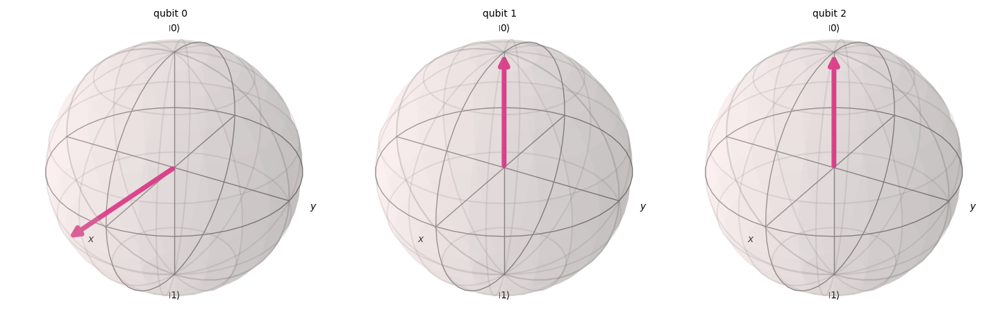
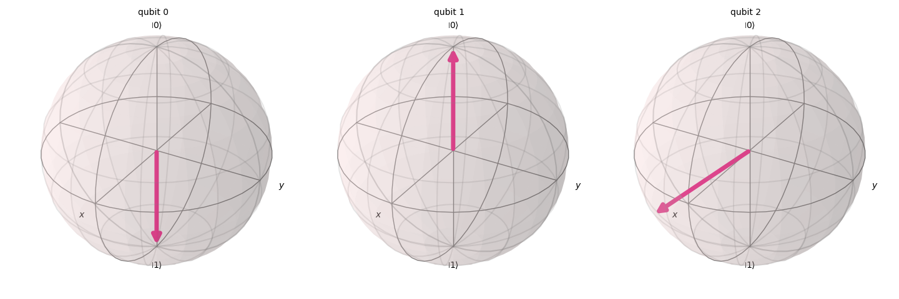
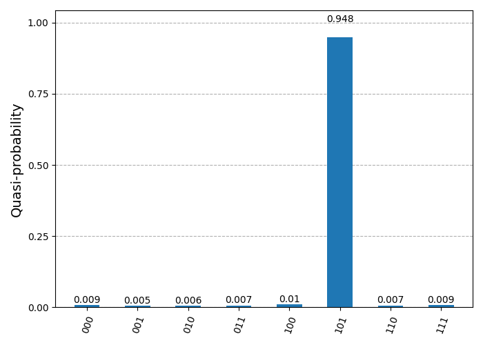

# Foundational Quantum Algorithms

Qiskit simulations of two introductory quantum algorithms: a three-qubit teleportation circuit and Grover search for the marked state `|101>`.

## Requirements

- Python 3
- `qiskit`
- `qiskit-aer`
- `matplotlib`
- `numpy`

Install with:

```bash
pip install qiskit qiskit-aer matplotlib numpy
```

## Quantum teleportation

Run:

```bash
python QuantumTeleportationCircuit.py
```

`QuantumTeleportationCircuit.py` uses a 3-qubit register and a 3-bit classical register.

1. Qubit 0 is prepared in a random state with `ry`, `rz`, and `rx`.
2. That initial state is plotted on the Bloch sphere for comparison.
3. Qubits 1 and 2 are entangled into a Bell pair. A Bell measurement is then performed on qubits 0 and 1.
4. Measurement outcomes on classical bits 0 and 1 control Bob’s corrections on qubit 2: **X** if bit 1 is 1, **Z** if bit 0 is 1 (matching the circuit).
5. The final statevector is plotted. Qubit 2 should match the original state of qubit 0. Qubit 1 is random after teleportation, consistent with the no-cloning theorem.

Each run uses a new random initial state, so the Bloch-sphere plots will differ.

**Example initial states**



**Example final states**



On trapped ions, the three qubits would be three ions in a trap (for example a linear Paul trap). Logical `|0>` and `|1>` are hyperfine ground states of the valence electrons. Single-qubit rotations are driven by lasers or microwaves (Rabi oscillation). The CNOT uses shared motion (phonons) of the ion chain. Measurement uses state-dependent fluorescence: the `|1>` state scatters photons that can be detected.

## Grover’s algorithm

Run:

```bash
python SimpleGroversAlgorithm.py
```

`SimpleGroversAlgorithm.py` searches a 3-qubit space for one marked state, `|101>`.

- **Oracle:** phase-marks `|101>` using an `H`, a multi-controlled X (`ctrl_state='01'`), then `H` on the last qubit (equivalent to a controlled-controlled-Z on that basis state).
- **Diffuser:** inversion about the mean, which amplifies the marked amplitude.
- **Iterations:** `round(π / (4α))` with `α = arcsin(√(1/8))`, then the oracle and diffuser are applied that many times.

The circuit is transpiled and run on `AerSimulator` with 1024 shots. Counts are printed and plotted. The `|101>` bin should dominate; shot noise means the histogram will vary slightly between runs.

**Example probability distribution**


